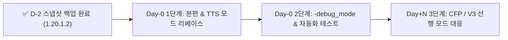

# 🧭 CK3 `Silk & Silver` & `1.21 "Florin"` 호환성 패치 준비 플레이북

**기준일:** 2026-11-15 (출시 D-2)  
**대상 업데이트:** *Crusader Kings III: Silk & Silver* 확장팩 + **1.21 "Florin"** 무료 업데이트 (**2026년 11월 17일 출시**)  
**핵심 분석 범위:** 개발일지 #9 (*3D Art, Music, & Modding*, DD #213) 및 연계 기술 변경점(DD #8 교역·모딩, DD #10 2D 아트)  
**점검 대상 모드:**
1. **커스텀 북마크 모드 3종 (`custom-mods/`, 현재 `1.20.*` / `v1.1.0`)**
   - 본편: [descriptor.mod](file:///c:/Users/blackolf/Documents/workspace/ck3-reincarnated-villains/custom-mods/reincarnated-villains-867/descriptor.mod) (`reincarnated-villains-867`)
   - CFP 호환 패치: [descriptor.mod](file:///c:/Users/blackolf/Documents/workspace/ck3-reincarnated-villains/custom-mods/reincarnated-villains-867-cfp-compatch/descriptor.mod) (`reincarnated-villains-867-cfp-compatch`)
   - V3 의상 패치: [descriptor.mod](file:///c:/Users/blackolf/Documents/workspace/ck3-reincarnated-villains/custom-mods/reincarnated-villains-867-v3-compatch/descriptor.mod) (`reincarnated-villains-867-v3-compatch`)
2. **본체 음성 리더 모드 (`ck3-mod/`)**
   - [descriptor.mod](file:///c:/Users/blackolf/Documents/workspace/ck3-tts-companion/ck3-mod/descriptor.mod) (`CK3 Event Voice Reader`)

---

## 1. 핵심 요약: 개발일지 #9 (`3D Art, Music, & Modding`) 및 `1.21` 주요 변경점

> [!IMPORTANT]
> 개발일지 #9에서 공개된 **신규 이발소/초상화 3D 에셋 88종 추가**는 현재 우리 북마크 본편과 CFP 호환 패치가 **통파일 오버라이드**하고 있는 유전자(`03`/`05_genes_*`) 및 이발소 모디파이어(`00_custom_*`) 파일과 **100% 직접 충돌**합니다. 출시 직후 최우선 3-Way 병합 대상입니다.

### 1-1. 3D 아트 & 초상화 / 이발소 (Dev Diary #9)
- **신규 초상화·이발소 아이템 총 88종 추가**:
  - **의상(Clothes) 28종**, **모자/머리장식(Headgear) 45종**, **망토(Cloaks) 14종**, **헤어스타일(Hairstyle) 1종** (상인·도제·실크로드·지중해·소그드·중국 상단 복식 중심).
  - 교역 행렬 및 거처 연출용 **3D 짐승 에셋(당나귀, 단봉낙타)** 및 **상인 저택(Merchant Mansion) 3D 소품/배경** 추가.
- **모드 영향**: 바닐라 `common/genes/03_genes_special_accessories_hairstyles.txt`, `05_genes_special_accessories_clothes.txt`, `gfx/portraits/portrait_modifiers/00_custom_clothes.txt`, `00_custom_hair.txt`, `gfx/portraits/portrait_animations/animations.txt`에 신규 템플릿·포즈가 대거 추가됨.

### 1-2. 음악 & 오디오 (Dev Diary #9)
- 실크로드·지중해 해양 공화국·시장 테마 신규 사운드트랙 및 환경음 큐(Cue) 추가.
- **모드 영향**: 커스텀 북마크 모드는 오디오 건드림이 없어 무영향이며, 본체 TTS 모드(`ck3-mod`)도 기존 처형 효과음 감시/오디오 덕킹과 충돌 가능성 극히 낮음.

### 1-3. 모딩 엔진(UGCx) & 스크립트 확장 (Dev Diary #8 & #9)
- **동적 거처(Domicile) 및 정부 스코프 지원 확장** (*PDX-CrimsonKepler* 발표):
  - 신규 이펙트 `create_domicile_title`: 바닐라 고정 정부 체제에 묶이지 않는 **커스텀 동적 작위 + 거처(Domicile)** 생성 지원.
  - `give_noble_family_title`, `create_nomad_title`, `create_adventurer_title` 이펙트가 하드코딩 대신 **정부 타입 스코프(Government Type Scope)**를 인자로 받을 수 있도록 확장됨.
- **스코프 유연화 & 도로(Road) 스크립팅 개방**:
  - `aptitude_compare` 트리거가 `court_position_type` 스코프를 직접 수용.
  - 도로 제어 스크립트 신설: `road_tier`, `set_road_tier`, `add_road_modifier`, `remove_road_modifier`, `has_road_modifier`, `every_road_in_province`.
- **교역·변수 맵(Variable Maps) & GUI 함수**:
  - 약 1,000개 시장 노드, 40여 종 교역품, 신규 정부 2종(**상인 `merchant`**, **공화국 `republic`**) 도입.
  - EU5/Vic3 방식의 **Variable Maps** 이식, `province_movement_speed` / `county_movement_speed`, `modifier_value` 트리거 및 `GetModifierValue` GUI 데이터 함수 추가.

---

## 2. 커스텀 북마크 모드 3종 (`custom-mods/`) 충돌 위험도 매트릭스

현재 `custom-mods/` 내 스크립트·GUI 파일을 전수 스캔하여 바닐라 `1.21` 업데이트 시 충돌 확률과 영향도를 3단계로 분류했습니다.

### 🔴 1순위: 출시 당일 필수 3-Way 리베이스 대상 (바닐라 통파일 오버라이드)

이 파일들은 바닐라 원본 파일명과 동일하여 `1.20.*` 베이스 위에 우리 항목을 덧붙인 구조입니다. 리베이스하지 않으면 **신규 DLC 북마크·신규 의상 88종·포즈가 인게임에서 증발하거나 `error.log` 크래시**를 유발합니다.

| 대상 모드 | 파일 경로 | `1.21` 충돌 사유 및 조치 방법 |
| :--- | :--- | :--- |
| **본편** | [00_bookmarks.txt](file:///c:/Users/blackolf/Documents/workspace/ck3-reincarnated-villains/custom-mods/reincarnated-villains-867/common/bookmarks/bookmarks/00_bookmarks.txt) | `Silk & Silver` 신규 상인/공화국 추천 북마크 추가 확실시. `1.21` 원본 `00_bookmarks.txt` 하단에 `bm_867_reincarnated_villains_west` / `_east` 블록 재이식 필수. |
| **본편 + CFP패치** | [05_genes_special_accessories_clothes.txt](file:///c:/Users/blackolf/Documents/workspace/ck3-reincarnated-villains/custom-mods/reincarnated-villains-867/common/genes/05_genes_special_accessories_clothes.txt) [05_genes_special_accessories_clothes.txt (CFP)](file:///c:/Users/blackolf/Documents/workspace/ck3-reincarnated-villains/custom-mods/reincarnated-villains-867-cfp-compatch/common/genes/05_genes_special_accessories_clothes.txt) | **DD #9 의상 28종 + 모자 45종 + 망토 14종 추가 직격탄.** `1.21` 유전자 템플릿(`index` 충돌 주의!) 위로 커스텀 의상/모자 유전자 블록 재병합 필수. |
| **본편 + CFP패치** | [03_genes_special_accessories_hairstyles.txt](file:///c:/Users/blackolf/Documents/workspace/ck3-reincarnated-villains/custom-mods/reincarnated-villains-867/common/genes/03_genes_special_accessories_hairstyles.txt) [03_genes_special_accessories_hairstyles.txt (CFP)](file:///c:/Users/blackolf/Documents/workspace/ck3-reincarnated-villains/custom-mods/reincarnated-villains-867-cfp-compatch/common/genes/03_genes_special_accessories_hairstyles.txt) | **DD #9 신규 헤어스타일 1종 추가 확정.** `1.21` 원본 대조 후 커스텀 헤어 템플릿 인덱스 재정렬 필수 (`04_genes_*_beards.txt`도 함께 Diff 점검). |
| **본편 + CFP패치** | [00_custom_clothes.txt](file:///c:/Users/blackolf/Documents/workspace/ck3-reincarnated-villains/custom-mods/reincarnated-villains-867/gfx/portraits/portrait_modifiers/00_custom_clothes.txt) [00_custom_hair.txt](file:///c:/Users/blackolf/Documents/workspace/ck3-reincarnated-villains/custom-mods/reincarnated-villains-867/gfx/portraits/portrait_modifiers/00_custom_hair.txt) [00_custom_beards.txt](file:///c:/Users/blackolf/Documents/workspace/ck3-reincarnated-villains/custom-mods/reincarnated-villains-867/gfx/portraits/portrait_modifiers/00_custom_beards.txt) | **DD #9 신규 이발소 아이템 88종 등록 파일.** 리베이스 누락 시 신규 DLC 의상/모자가 이발소 목록에서 사라짐 (`cfp-compatch`의 동명 파일 2종 포함). |
| **본편** | [animations.txt](file:///c:/Users/blackolf/Documents/workspace/ck3-reincarnated-villains/custom-mods/reincarnated-villains-867/gfx/portraits/portrait_animations/animations.txt) | `1.21` 상인/공화국 전용 초상화 애니메이션이나 이벤트 포즈 추가 여부 Diff 확인 후 커스텀 애니메이션 병합. |
| **본편** | [00_council_positions.txt](file:///c:/Users/blackolf/Documents/workspace/ck3-reincarnated-villains/custom-mods/reincarnated-villains-867/common/council_positions/00_council_positions.txt) | 신규 `merchant` / `republic` 정부용 자문회 조건이 바닐라 자문회 직책에 추가될 가능성 높음. `1.21` 변경점 병합(또는 `zzz_` 키 단위 분리 가능 여부 검증). |

---

### 🟡 2순위: 부분 오버라이드 & 경제·역사·HUD 드리프트 점검 대상

파일명은 모듈화되어 있거나 특정 권역만 덮어쓰지만, `1.21`의 **경제·건물 개편, 이탈리아 공화국/실크로드 맵 개편, 상단 HUD 개편**과 맞물리는 파일들입니다.

| 도메인 | 점검 파일 | `1.21` 중점 확인 포인트 |
| :--- | :--- | :--- |
| **상단 HUD / 신앙 UI** | [00_villains_piety_hud.gui](file:///c:/Users/blackolf/Documents/workspace/ck3-reincarnated-villains/custom-mods/reincarnated-villains-867/gui/00_villains_piety_hud.gui) | `resources_top_right_bar`, `hbox_vassal_taxes`, `cost_breakdown_vbox`를 오버라이드 중. `1.21`에서 우측 상단 자원 바에 **교역/시장 관련 신규 수치나 아이콘**이 추가되었는지 반드시 바닐라 `hud.gui`와 비교! |
| **경제 건물 (주체 물레방아)** | [zzz_villains_watermills.txt](file:///c:/Users/blackolf/Documents/workspace/ck3-reincarnated-villains/custom-mods/reincarnated-villains-867/common/buildings/zzz_villains_watermills.txt) | `1.21`은 건물·교역품 생산 구조를 전면 개편함. 바닐라 `watermills_01`~`08`에 신규 교역품 보너스나 비용/트리거 변경이 들어갔는지 대조 필수. |
| **정부·종교 트리거** | [zzz_villains_government_triggers.txt](file:///c:/Users/blackolf/Documents/workspace/ck3-reincarnated-villains/custom-mods/reincarnated-villains-867/common/scripted_triggers/zzz_villains_government_triggers.txt) [10_doctrines_religions.txt](file:///c:/Users/blackolf/Documents/workspace/ck3-reincarnated-villains/custom-mods/reincarnated-villains-867/common/religion/doctrine_types/10_doctrines_religions.txt) | `administrative_counts_can_be_independent` 등 덮어쓴 바닐라 트리거에 신규 `merchant` / `republic` 정부 조건이 추가되었는지 확인. |
| **작위/프로빈스 역사 (10개 권역)** | [k_italy.txt](file:///c:/Users/blackolf/Documents/workspace/ck3-reincarnated-villains/custom-mods/reincarnated-villains-867/history/titles/k_italy.txt), [k_jerusalem.txt](file:///c:/Users/blackolf/Documents/workspace/ck3-reincarnated-villains/custom-mods/reincarnated-villains-867/history/titles/k_jerusalem.txt), [e_china.txt](file:///c:/Users/blackolf/Documents/workspace/ck3-reincarnated-villains/custom-mods/reincarnated-villains-867/history/titles/e_china.txt), [01_admin_titles_tgp.txt](file:///c:/Users/blackolf/Documents/workspace/ck3-reincarnated-villains/custom-mods/reincarnated-villains-867/history/titles/01_admin_titles_tgp.txt) 외 `history/provinces/*`, [00_wars.txt](file:///c:/Users/blackolf/Documents/workspace/ck3-reincarnated-villains/custom-mods/reincarnated-villains-867/history/wars/00_wars.txt) | **특히 이탈리아(`k_italy`: 베네치아·제노바·밀라노 인접), 레반트(`k_jerusalem`), 중국 강남(`e_china` / `h_china`)**에서 867년 시장 거점·공화국 작위·초기 전쟁 설정이 바닐라에서 수정되었는지 3-Way Diff 수행. |
| **귀족 가문 거처 생성 스크립트** | [zzz_villains_on_actions.txt](file:///c:/Users/blackolf/Documents/workspace/ck3-reincarnated-villains/custom-mods/reincarnated-villains-867/common/on_action/zzz_villains_on_actions.txt) [zzz_villains_characters.txt](file:///c:/Users/blackolf/Documents/workspace/ck3-reincarnated-villains/custom-mods/reincarnated-villains-867/history/characters/zzz_villains_characters.txt) | DD #9에서 `give_noble_family_title` 및 `create_adventurer_title`이 정부 스코프 인자를 받도록 확장됨. 기존 문법 하위 호환성 유지 여부를 `-debug_mode` `error.log`로 즉시 검증 (트럼프·네타냐후·장칭·라스푸틴). |
| **커스텀 로컬라이제이션** | [00_divinity_custom_loc.txt](file:///c:/Users/blackolf/Documents/workspace/ck3-reincarnated-villains/custom-mods/reincarnated-villains-867/common/customizable_localization/00_divinity_custom_loc.txt) [00_martial_lifestyle_custom_loc.txt](file:///c:/Users/blackolf/Documents/workspace/ck3-reincarnated-villains/custom-mods/reincarnated-villains-867/common/customizable_localization/00_martial_lifestyle_custom_loc.txt) [00_pet_custom_loc.txt](file:///c:/Users/blackolf/Documents/workspace/ck3-reincarnated-villains/custom-mods/reincarnated-villains-867/common/customizable_localization/00_pet_custom_loc.txt) | 바닐라 `1.21`에서 해당 파일들에 신규 텍스트 분기가 추가되었는지 간단한 Diff 체크. |

---

### 🟢 3순위: 저위험 / 외부 선행 모드 의존 영역

- **본편 `zzz_villains_*` 독립 파일군** (신규 문화 10종, 신앙 11종, 유물, 문장, 무장병, 결단, DNA 등): 고유 네임스페이스로 격리되어 있어 바닐라 충돌 위험이 매우 낮습니다.
- **V3 의상 서브모드 (`reincarnated-villains-867-v3-compatch`)**:
  - 모든 파일이 `zzz_z_villains_v3_*` 접두사로 분리되어 바닐라 통파일 오버라이드가 **0건**입니다!
  - 단, 선행 모드인 **Victoria3 Crossgame Portriat (`3836483821`)** 자체가 `1.21` 유전자 파일에 맞춰 업데이트되어야 정상 작동하며, 선행 모드 업데이트 시 신규 키가 추가되었는지만 확인하여 [zzz_v3_xgp_l_korean.yml](file:///c:/Users/blackolf/Documents/workspace/ck3-reincarnated-villains/custom-mods/reincarnated-villains-867-v3-compatch/localization/korean/zzz_v3_xgp_l_korean.yml)을 증분 갱신하면 됩니다.
- **CFP 호환 서브모드 (`reincarnated-villains-867-cfp-compatch`)**:
  - 선행 모드인 **Community Flavor Pack (`2220098919`)**이 `1.21` 대응 업데이트를 배포한 직후, CFP의 신규 `03`/`04`/`05_genes_*` 및 `00_custom_*`를 베이스로 재병합합니다.

---

## 3. 본체 TTS 모드 (`ck3-mod/`) `1.21` 호환성 핵심 타깃

워크스페이스의 본체 모드인 `CK3 Event Voice Reader`(총 22개 `.gui` + 셰이더 1종 + 처형 이펙트 1종)는 프로젝트의 **`mod-compat-harness`**([SKILL.md](file:///c:/Users/blackolf/Documents/workspace/ck3-reincarnated-villains/.agents/skills/mod-compat-harness/SKILL.md))로 반자동 3-Way 리베이스가 가능하며, `1.21`에서 특히 주의할 파일은 다음 4개 영역입니다:

1. **[cooltip.gui](file:///c:/Users/blackolf/Documents/workspace/ck3-tts-companion/ck3-mod/gui/shared/cooltip.gui) (최우선 주의)**: `1.21`에서 **신규 교역품·시장·도로 툴팁 템플릿**이 대거 추가될 가능성이 매우 높음.
2. **[window_activity.gui](file:///c:/Users/blackolf/Documents/workspace/ck3-tts-companion/ck3-mod/gui/window_activity.gui), [window_activity_locale.gui](file:///c:/Users/blackolf/Documents/workspace/ck3-tts-companion/ck3-mod/gui/window_activity_locale.gui), [window_royal_court.gui](file:///c:/Users/blackolf/Documents/workspace/ck3-tts-companion/ck3-mod/gui/window_royal_court.gui)**: 신규 교역 원정 활동 및 상인/공화국 궁정 UI 변경 여부 대조.
3. **`gui/event_windows/*.gui` (11종) & [event_windows.gui](file:///c:/Users/blackolf/Documents/workspace/ck3-tts-companion/ck3-mod/gui/shared/event_windows.gui)**: 신규 상단/무역 이벤트 창 레이아웃 변경 여부 점검 후 TTS 훅(`show` 체인, `CopyStringToClipboard`, `tts_speak_button`, STOP 바인딩) 재이식.
4. **[court_scene.shader](file:///c:/Users/blackolf/Documents/workspace/ck3-tts-companion/ck3-mod/gfx/FX/court_scene.shader) & [zz_tts_companion_prison_effects.txt](file:///c:/Users/blackolf/Documents/workspace/ck3-tts-companion/ck3-mod/common/scripted_effects/zz_tts_companion_prison_effects.txt)**: `1.21` 3D 렌더링 셰이더 변경점 및 `00_prison_effects.txt`의 `execute_prisoner_effect` 변경 여부 Diff 확인.

---

## 4. 단계별 실행 로드맵 (D-2 사전 준비 $\rightarrow$ 출시 당일 Day-0)

### Phase A. 출시 전(지금 ~ 11/17 패치 직전) 사전 작업 현황
1. ✅ **[완료] `1.20.1.2 (Crozier)` 바닐라 & 선행 모드 원본 베이스 스냅샷 백업**
   - **디렉터리**: `scratch/ck3-1.20.1.2-baseline/` ([manifest.json](file:///c:/Users/blackolf/Documents/workspace/ck3-reincarnated-villains/scratch/ck3-1.20.1.2-baseline/manifest.json) — 전 파일 SHA-256 해시 기록)
   - **읽기 전용 아카이브**: [ck3-1.20.1.2-baseline.zip](file:///c:/Users/blackolf/Documents/workspace/ck3-reincarnated-villains/scratch/ck3-1.20.1.2-baseline.zip) (`0.94 MiB`, 총 **168개 파일** / 원본 `8.84 MiB`, `.gitignore` 격리 완료)
   - **백업 내역**:
     - `vanilla-game` (**120개**): `custom-mods/` 및 `ck3-mod/`가 오버라이드하거나 부분 참조하는 바닐라 원본 파일 전수
     - `workshop-cfp-2220098919` (**34개**): CFP(`1.20`) 유전자·이발소 모디파이어 전수
     - `workshop-v3-xgp-3836483821` (**14개**): V3 Crossgame Portrait(`1.20`) 유전자·액세서리·영/중 로컬라이제이션 전수
2. **[선택] 통파일 오버라이드 사전 경량화 검토**
   - [00_council_positions.txt](file:///c:/Users/blackolf/Documents/workspace/ck3-reincarnated-villains/custom-mods/reincarnated-villains-867/common/council_positions/00_council_positions.txt), [10_doctrines_religions.txt](file:///c:/Users/blackolf/Documents/workspace/ck3-reincarnated-villains/custom-mods/reincarnated-villains-867/common/religion/doctrine_types/10_doctrines_religions.txt), `00_*_custom_loc.txt` 중 수정된 키만 `zzz_villains_*`로 분리 가능한 항목을 미리 경량화해 두면 앞으로의 버전업 유지보수가 훨씬 편해집니다.

### Phase B. 출시 당일(11/17 패치 직후) 실행 순서
1. **1차 패치 (외부 모드 의존성 없는 본편 2종 즉시 업데이트)**
   - 스팀 CK3 `1.21` 업데이트 완료 후 `"바닐라 업데이트 반영해줘"` (`mod-compat-harness`) 실행:
     - **본체 TTS 모드 (`ck3-mod/`)**: GUI 30종 + 디버그 은닉 스크립트 3-Way 리베이스 및 `npm test` 통과 확인.
     - **전생한 악당들 본편 (`reincarnated-villains-867`)**: 🔴 1순위 파일 7종 + 🟡 2순위 파일(`watermills`, `piety_hud`, `history/*`) 3-Way 병합 후 `supported_version="1.21.*"` 갱신 및 `npx tsx --test test/customMod*.test.ts` 검증.
   - 인게임 `-debug_mode`로 서방편/동방편 북마크 진입, 이발소 열기(신규 88종 의상 노출 확인), 상단 HUD/시장 맵모드 정상 출력 및 `error.log` 클린 확인 후 스팀 창작마당 즉시 업데이트 (`v1.1.1` 또는 `v1.2.0`).
2. **2차 패치 (선행 모드 업데이트 배포 후 서브모드 2종 업데이트)**
   - **V3 의상 패치 (`v3-compatch`)**: 선행 모드(`3836483821`)의 `1.21` 업데이트 확인 후 `supported_version="1.21.*"` 범프 및 신규 한글화 키 유무 점검.
   - **CFP 호환 패치 (`cfp-compatch`)**: CFP(`2220098919`)의 `1.21` 업데이트 확인 후 `1.21 바닐라 + 신규 CFP + 악당들 의상/헤어` 3자 병합 수행.

---

## 5. (참고) `Silk & Silver` 신규 기능을 활용한 차기 콘텐츠 확장 아이디어 (`v1.2+`)

단순 호환성 패치를 넘어, 이번 DLC/업데이트에서 풀리는 신규 메커니즘 중 우리 북마크 캐릭터들과 찰떡궁합인 요소들입니다:
- **도널드 트럼프 (`마러라고 자유특구`)**: 신규 **상인(`merchant`) / 무역 회사 도미사일** 또는 `republic` 공화국 메커니즘과 결합해 진짜 '트럼프 타워 상단 / 관세 무역전쟁' 플레이 지원 가능.
- **커스텀 동적 거처 (`create_domicile_title`)**: DD #9에서 정부 체제 제약이 풀린 동적 거처 생성 이펙트를 활용해 각 진영의 고유 총통부/사령부 거처 구현 가능.
- **도로 스크립팅 (`set_road_tier`, `add_road_modifier`)**: 무솔리니의 '아우토스트라다 건설', 스탈린의 '5개년 철도망', 김정은의 '속도전 도로 건설' 고유 결단 보상으로 실제 프로빈스 도로 티어 상승 효과 부여 가능.
